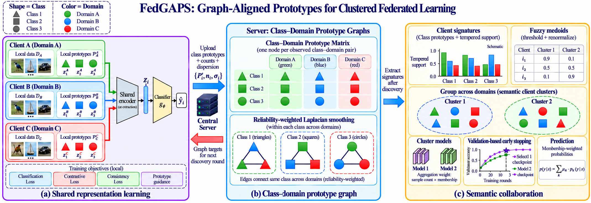

# FedGAPS

**Graph-Aligned Prototypes for Clustered Federated Learning**

Code for the main benchmark, eight baselines, six ablations, hyperparameter sensitivity, prototype geometry, and collaborator-selection studies on Digits-5, Office-10, and DomainNet-10.



**Overview of FedGAPS.** Shapes denote classes and colors denote acquisition domains. **(a)** Clients learn a shared discovery representation and compute class prototypes with support statistics. **(b)** The server aggregates prototypes within class–domain pairs and constructs same-class cross-domain graphs. Reliability-weighted graph smoothing produces prototype targets that guide subsequent representation learning. **(c)** Clients recompute local signatures in the learned representation space. Reliability-tempered signature comparisons yield fuzzy memberships, which guide cluster-specific training and prediction. Validation-based early stopping selects a checkpoint separately for each cluster. The illustrated memberships and learning curves are schematic.

## Installation

The code uses Python 3.10 or newer, PyTorch, and torchvision. You can use your existing CUDA-enabled PyTorch environment.

From this repository's root:

```bash
python -m pip install -e .
python -c "import torch; print(torch.__version__); print('CUDA:', torch.cuda.is_available())"
python -m icde --help
```

Extract the archive and run each notebook or script from its experiment directory. Each experiment folder contains its own training modules and configuration.

## Data

Datasets and trained checkpoints are not included. Use a shared data directory containing:

```text
data/
  digits5/
  office10/
  domainnet10/
```

Set `--data-root` to the directory containing the dataset folders, for example `/path/to/data`. Enclose paths containing spaces in quotation marks.

Dataset preparation and layouts: [Digits-5](docs/DIGITS5_SETUP.md), [Office-10](reference/README_OFFICE10.md), [DomainNet-10](reference/README_DOMAINNET10.md). DomainNet-10 uses ten classes across six domains. The main benchmark also retains the separate [DomainNet-40 adapter](reference/README_DOMAINNET40.md).

## Main benchmark: baselines and ablations

The main configurations use seeds **42, 123, 2024**, Dirichlet **α = 0.1 and 0.5**, and four clients per domain. Models use ResNet-18, up to 50 rounds, and validation patience 5. Full settings are in the JSON configurations. AMP is off by default.

| Methods | Implementation names |
|---|---|
| FedGAPS | `ours` |
| Eight baselines | `fedavg`, `fedbn`, `fedproto`, `fedplvm`, `feddap`, `fedrc`, `fpl`, `fedsoft` |
| Without graph guidance | `ours_no_graph` |
| Without reliability weighting | `ours_no_reliability` |
| Hard memberships | `ours_hard` |
| Without the global-centre term | `ours_no_global_centre` |
| Without the margin term | `ours_no_margin` |
| Fixed cluster rounds | `ours_fixed_rounds` |

We implement the baselines within a shared training and evaluation protocol. Implementation details, differences from the original methods, and references are listed in [BASELINES.md](docs/BASELINES.md).

For Jupyter, open [`Run_Benchmark.ipynb`](Run_Benchmark.ipynb). From a terminal, plan first, then execute:

```bash
python -m icde sweep --config configs/digits5.json --ablations
python -m icde sweep --config configs/digits5.json --ablations --execute --resume
python -m icde sweep --config configs/office10.json --ablations --execute --resume
python -m icde sweep --config configs/domainnet10.json --ablations --execute --resume
```

Set data and output paths in the configuration or use `--data-root` and `--output-root`. Each dataset has **90 runs with ablations** (15 methods × 2 concentrations × 3 seeds), or **54 without ablations**. To run only two seeds, edit the suite's seed list; that gives 60 or 36 runs respectively. The main summary completeness flag expects the supplied three-seed protocol.

```bash
python -m icde smoke --output-root outputs/synthetic_smoke --device cpu
python -m icde summarize --output-root outputs/digits5_patience5
```

The smoke test runs a small synthetic experiment to check the installation. Evaluation and checkpoint selection are described in [PROTOCOL.md](docs/PROTOCOL.md).

## Sensitivity: graph strength and reliability

The three complete sensitivity packages are in:

- [`experiments/sensitivity/digits5`](experiments/sensitivity/digits5)
- [`experiments/sensitivity/office10`](experiments/sensitivity/office10)
- [`experiments/sensitivity/domainnet10`](experiments/sensitivity/domainnet10)

Each uses **α = 0.1**, seeds **42 and 123**, and eight distinct settings:

- Graph strength `graph_lambda`: 0.01, 0.05, 0.1, 0.2, 0.5, with `tempering_beta = 0.5`.
- Reliability tempering `tempering_beta`: 0.25, 0.5, 0.75, 1.0, with `graph_lambda = 0.1`.

The shared default is trained once per seed: **16 runs per dataset**, 48 across all three datasets. We vary one parameter at a time while holding the other at its default. Summaries report mean and sample standard deviation over two seeds.

Example, from the repository root:

```bash
cd experiments/sensitivity/digits5
python run_sensitivity.py --data-root /absolute/path/to/data --output outputs/sensitivity --device cuda --workers 4 --batch-size 64 --amp --plan-only
python run_sensitivity.py --data-root /absolute/path/to/data --output outputs/sensitivity --device cuda --workers 4 --batch-size 64 --amp --resume
python summarize_sensitivity.py --output outputs/sensitivity
```

For Office-10 or DomainNet-10, enter the corresponding directory and use batch size 32. Each directory also contains a runnable notebook. Save new settings in a separate output directory.

## Additional experiments

| Directory | Purpose | Default scope |
|---|---|---|
| `experiments/geometry/digits5` | Initial, learned, and smoothed prototype geometry | 4 runs: two α values × two seeds |
| `experiments/geometry/office10` | Same geometry analysis | 4 runs |
| `experiments/geometry/domainnet10` | Same geometry analysis | 4 runs |
| `experiments/diagnostic_pilot` | Check whether diagnostic exports alter training or predictions | Matched exports-on/off pilot |
| `experiments/collaborator_study` | Histogram controls, alternative grouping, planted-group recovery, and communication accounting | 12 Dirichlet jobs + 22 planted jobs |

Each subproject includes its own README, runner, and analysis scripts. Geometry's selected raw and smoothed prototypes come from the **same selected checkpoint**; initial prototypes are a separate pre-discovery snapshot.

The collaborator study covers all three datasets, with sample allocation adapted to the smaller Office-10 domains. The Dirichlet suite uses **α = 0.1**. With two seeds, `--suite both` runs 34 jobs covering discovery and downstream training. The planted suite alone runs 22 jobs.

```bash
cd experiments/collaborator_study
python run_study.py --dataset digits5 --suite both --data-root /absolute/path/to/data --output outputs/digits5_study --seeds 42 123 --device cuda --workers 4 --batch-size 64 --amp --plan-only
```

Remove `--plan-only` and add `--resume` to execute. Use batch size 32 for the other datasets. Consult this subproject's README for capacity checks, reuse requirements, and output verification.

The matched histogram and prototype comparisons share the discovery stage. Communication is estimated from the model and summary payloads exchanged during discovery and downstream training.

## Reproducibility and source layout

- `icde/`, `reference/`, and `configs/`: main benchmark implementation and settings.
- `experiments/`: isolated implementations for the later studies.
- `docs/SOURCE_MANIFEST.json`: source locations and SHA-256 hashes of packaged Python files.
- `docs/RELEASE_VALIDATION.md`: checks performed for this bundle.

The repository includes source code and notebooks. Datasets, results, and checkpoints are stored separately. To resume an existing run, use its original configuration and source version.

License: not yet specified.
